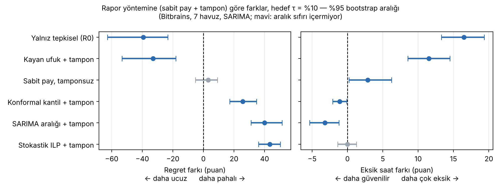

# Kubernetes Ortamında Kaynak Kullanımı Tahmini ve Tamsayılı Doğrusal Programlama ile Maliyet-Optimal Kapasite Planlaması

**MTM4991 – Çok Disiplinli Tasarım Projesi** · Yıldız Teknik Üniversitesi, Matematik Mühendisliği Bölümü
Berkay Dişli · Danışman: Doç. Dr. Kadriye Şimşek Alan · 2026–2027 Güz

> **In short (EN):** Day-ahead forecasting of a Kubernetes node pool's CPU and memory demand (seasonal naive,
> last value, SARIMA, LSTM) feeding a multi-period integer linear program (start-up costs, minimum run time,
> three AWS EC2 instance types) that picks the cheapest server plan, combined with an HPA-like reactive buffer.
> Evaluated on real traces (Bitbrains GWA-T-12, Alibaba cluster-trace-v2018) and run live on a kind + KWOK
> Kubernetes cluster.

## Ne yapıyor?

Bir düğüm havuzunun yarın her saat ne kadar işlemci ve bellek isteyeceği tahmin edilir; bu tahmine göre
hangi sunucu tipinden kaç tane çalıştırılacağı, maliyeti en küçükleyen bir ILP modeliyle belirlenir. Plan
tahmine göre yapılır, başarısı gerçekleşen talep üzerinden ölçülür. Tahmin hatalarına karşı plana, bir önceki
saatin gözlenen talebine göre büyüyüp küçülen tepkisel bir tampon eklenir (hibrit strateji).

```
ham iş yükü izleri ─► ön işleme (5 dk ızgara, havuz toplamı, saatlik TEPE talep)
                          │
                          ▼
           gün-ileri tahmin (naif, son değer, SARIMA, LSTM)
                          │  D̂_cpu, D̂_mem (24 saat)
                          ▼
     çok dönemli ILP (OR-Tools + SCIP) ─► sunucu planı x_{k,t}  ─┐
     gözlenen talep (bir önceki saat) ─► tepkisel tampon (R2) ──┴─► değerlendirme (maliyet, eksik kapasite)
```

**ILP modeli** (ayrıntılar `MIMARI.md` Bölüm 6):

```
min  Σ_t Σ_k  c_k x_kt + s_k y_kt + d_k z_kt
s.t. Σ_k C_k x_kt ≥ (1+α) D̂^cpu_t ,   Σ_k M_k x_kt ≥ (1+α) D̂^mem_t        (kapasite)
     x_kt − x_k,t−1 = y_kt − z_kt                                          (durum geçişi)
     Σ_{τ=t−L_k+1..t} y_kτ ≤ x_kt                                           (minimum çalışma süresi)
     x, y, z ∈ Z≥0
```

## Öne çıkan bulgular

- Saat içi tepe talep, saatlik ortalamayı 1,02–1,37 kat aşıyor; planlama tepe talebe göre yapılmalı.
- Tahmin modelleri arasındaki farklar istatistiksel olarak çoğunlukla anlamsız (Diebold–Mariano); maliyeti
  asıl belirleyen, planın nasıl kurulduğu.
- Basit güvenlik paylı ILP planı + tepkisel tampon, denenen ileri yöntemlerden (kayan ufuk, konformal kantil,
  iki aşamalı stokastik ILP) daha sağlam çıktı: ileri yöntemler ya ucuzluk ya güvence getirdi, ikisini birden
  değil. Farklar eşleştirilmiş gün blok bootstrap ile sınandı (aşağıdaki şekil).
- ILP bir günlük planı ortalama 0,02–0,04 saniyede en iyi çözüme ulaştırıyor; LP gevşetmesi + yuvarlama en kötü
  durumda %12,9 daha pahalı.



## Klasör yapısı

```
configs/       Tüm parametreler (ön işleme, havuzlar, tahmin, ILP, sunucu tipleri, sentetik senaryolar)
src/           ingest/preprocess (veri), eda, forecast/ (tahmin), ilp/ (model, çözüm), baselines/ (R0/R1/R2),
               evaluate, izgara (duyarlılık), sentetik, kayan_*/kantil_*/stokastik_* (ileri yöntemler),
               gecikme_deney, istatistik
tests/         Birim testleri (pytest)
demo/          Canlı Kubernetes demosu (kind + KWOK + Streamlit paneli) → demo/README.md
outputs/       Deney çıktıları (CSV, şekiller); data/ (ham veri, ~14 GB) depoya dahil değildir
rapor_kaynak/  Raporun (DD-050 biçimi, Word) kaynak betikleri
MIMARI.md      Ayrıntılı tasarım belgesi: veri kuralları, model, ölçütler, kilometre taşları
```

## Kurulum

Linux, Python 3.12. LSTM için NVIDIA GPU önerilir (CPU ile de çalışır, daha yavaş).

```bash
python3 -m venv .venv
.venv/bin/pip install -r requirements.txt
.venv/bin/python -m pytest -q
```

**Veri** (depoya dahil değildir, `data/raw/` altına indirilir):

- Bitbrains GWA-T-12 (fastStorage, Rnd) – Grid Workloads Archive, TU Delft
- Alibaba cluster-trace-v2018 (`machine_usage`, `machine_meta`) – github.com/alibaba/clusterdata

## Çalıştırma sırası

Tüm komutlar proje kökünden, `.venv/bin/python -m ...` biçiminde çalıştırılır.

| Adım | Komut |
|---|---|
| Veri | `src.ingest`, `src.preprocess`, `src.ingest_alibaba`, `src.preprocess_alibaba` |
| Keşifsel analiz | `src.eda` |
| Tahmin | `src.forecast.naif`, `src.forecast.sarima`, `src.forecast.lstm`, `src.forecast.ozet` |
| Fiyatlar | `src.ilp.fiyat_cek` (AWS fiyat listesi, tarihli anlık görüntü) |
| ILP planları | `src.ilp.solve` |
| Tepkisel / hibrit stratejiler | `src.baselines.tepkisel` |
| Duyarlılık ve sentetik senaryolar | `src.izgara`, `src.sentetik` |
| İleri yöntemler | `src.kayan_karsilastirma`, `src.kantil_karsilastirma`, `src.stokastik_karsilastirma` |
| Sağlamlık | `src.gecikme_deney`, `src.istatistik` |
| Rapor tabloları ve şekilleri | `src.rapor` |

Canlı Kubernetes demosu için: [`demo/README.md`](demo/README.md).

## Veri kaynakları

- Shen, S., van Beek, V. et al. (2015), "Statistical Characterization of Business-Critical Workloads Hosted
  in Cloud Datacenters", CCGrid 2015. Veri: Bitbrains IT Services Inc.
- Guo, J., Chang, Z. et al. (2019), "Who Limits the Resource Efficiency of My Datacenter: An Analysis of
  Alibaba Datacenter Traces", IWQoS 2019.
