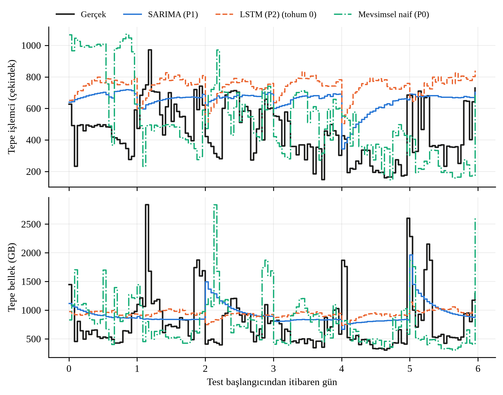
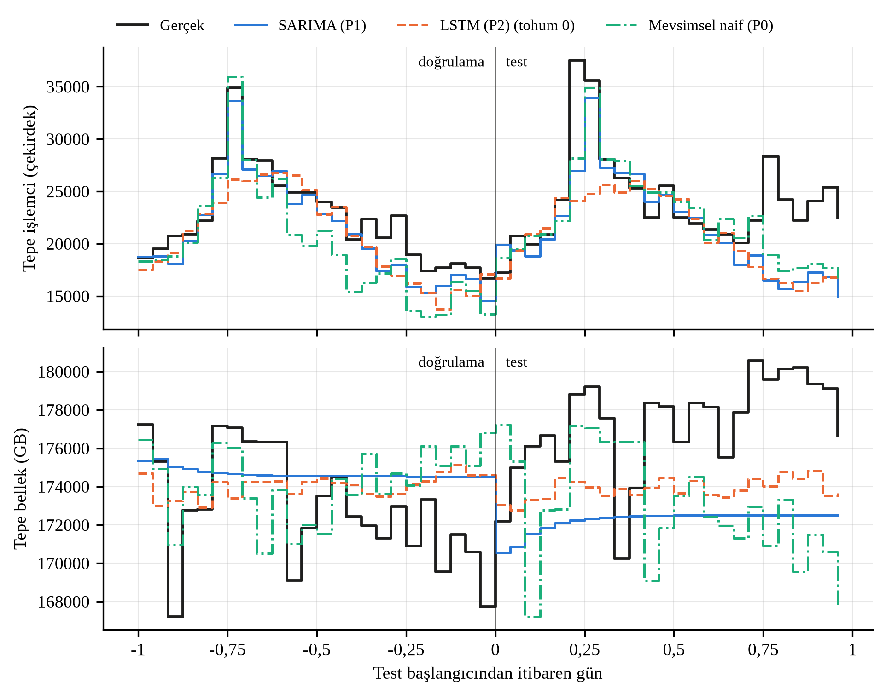
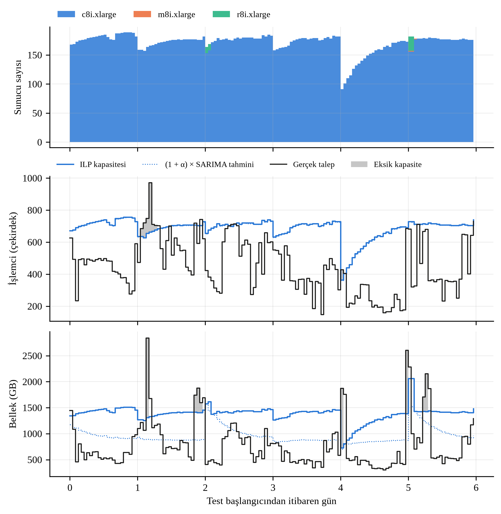
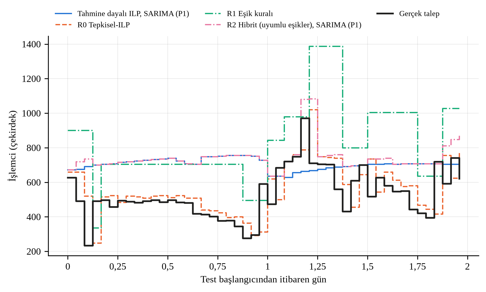
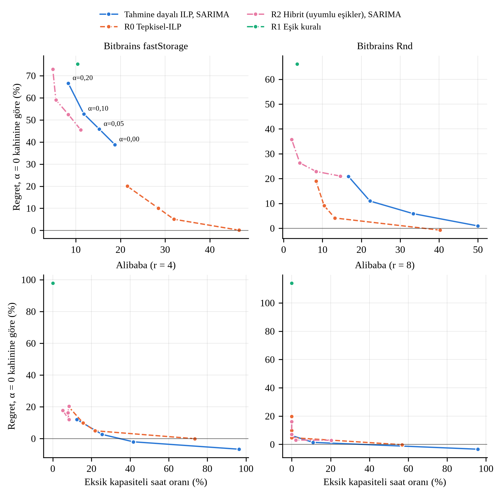
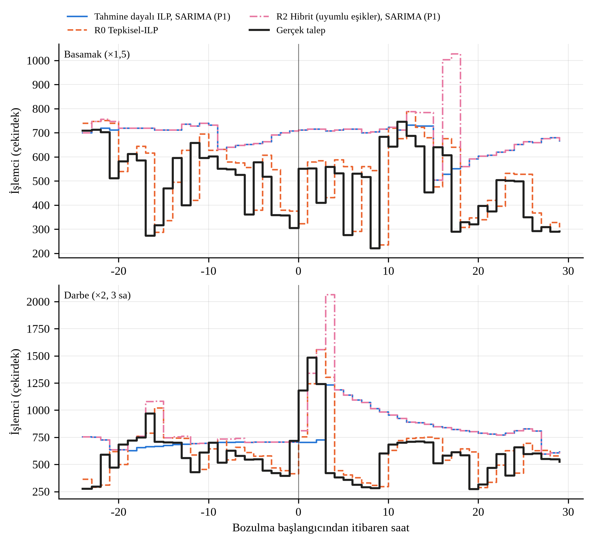

# Rapor şekil ve tablo kataloğu (M8)

Otomatik üretildi: `src/rapor.py`. Altyazılar öneridir. Sıra: `configs/rapor.yaml`.

## Tablo 3.1 Sunucu tipleri ve özellikleri (AWS EC2 on-demand, Linux, eu-central-1)
*Kapasite Planlama Modeli* — `tablo_3_1_sunucu_tipleri.csv`

| Tip | Aile | vCPU (çekirdek) | Bellek (GiB) | GB/vCPU | Saatlik maliyet (USD) |
|---|---|---|---|---|---|
| c8i.xlarge | Hesaplama optimize | 4 | 8 | 2 | 0,21388 |
| m8i.xlarge | Genel amaçlı | 4 | 16 | 4 | 0,25358 |
| r8i.xlarge | Bellek optimize | 4 | 32 | 8 | 0,33516 |

## Tablo 4.1 Test dönemi gün-ileri tahmin ölçütleri (havuzlar üzerinden ortalama ± standart sapma)
*Tahmin Sonuçları* — `tablo_4_1_tahmin_olcutleri.csv`

| Grup | Kaynak | Model | MAE | RMSE | MAPE (%) | MASE | Eksik tahmin (%) |
|---|---|---|---|---|---|---|---|
| Bitbrains fastStorage | İşlemci | SARIMA (P1) | 223,6 | 263,5 | 73,2 | 0,72 | 14,6 |
| Bitbrains fastStorage | İşlemci | LSTM (P2) | 310,4 ± 19,1 | 350,7 ± 16,0 | 99,0 ± 5,0 | 1,00 ± 0,06 | 3,5 ± 1,2 |
| Bitbrains fastStorage | İşlemci | Mevsimsel naif (P0) | 242,8 | 308,0 | 64,0 | 0,78 | 46,5 |
| Bitbrains fastStorage | İşlemci | Son değer (P0) | 162,4 | 200,2 | 47,9 | 0,52 | 19,4 |
| Bitbrains fastStorage | Bellek | SARIMA (P1) | 378,9 | 482,6 | 61,2 | 1,04 | 26,4 |
| Bitbrains fastStorage | Bellek | LSTM (P2) | 389,2 ± 6,1 | 481,4 ± 3,1 | 63,2 ± 1,5 | 1,07 ± 0,02 | 25,2 ± 0,8 |
| Bitbrains fastStorage | Bellek | Mevsimsel naif (P0) | 433,8 | 607,5 | 60,8 | 1,20 | 50,0 |
| Bitbrains fastStorage | Bellek | Son değer (P0) | 693,4 | 922,6 | 108,8 | 1,91 | 14,6 |
| Bitbrains Rnd | İşlemci | SARIMA (P1) | 69,8 | 124,9 | 37,3 | 0,62 | 56,9 |
| Bitbrains Rnd | İşlemci | LSTM (P2) | 102,6 ± 2,2 | 115,7 ± 1,2 | 71,5 ± 1,2 | 0,91 ± 0,02 | 59,5 ± 0,8 |
| Bitbrains Rnd | İşlemci | Mevsimsel naif (P0) | 109,7 | 157,7 | 64,3 | 0,97 | 41,0 |
| Bitbrains Rnd | İşlemci | Son değer (P0) | 69,5 | 125,1 | 38,0 | 0,62 | 52,1 |
| Bitbrains Rnd | Bellek | SARIMA (P1) | 81,1 | 119,9 | 26,7 | 0,70 | 37,5 |
| Bitbrains Rnd | Bellek | LSTM (P2) | 86,1 ± 3,4 | 107,7 ± 2,4 | 31,2 ± 1,1 | 0,74 ± 0,03 | 41,7 ± 1,4 |
| Bitbrains Rnd | Bellek | Mevsimsel naif (P0) | 107,3 | 152,7 | 33,2 | 0,92 | 41,0 |
| Bitbrains Rnd | Bellek | Son değer (P0) | 94,9 | 144,7 | 29,1 | 0,82 | 38,9 |
| Bitbrains fastStorage alt havuzları | İşlemci | SARIMA (P1) | 46,4 ± 8,3 | 55,3 ± 8,8 | 81,9 ± 18,1 | 0,73 ± 0,10 | 14,7 ± 6,7 |
| Bitbrains fastStorage alt havuzları | İşlemci | LSTM (P2) | 61,6 ± 13,0 | 70,9 ± 12,6 | 106,1 ± 25,4 | 0,97 ± 0,17 | 6,5 ± 5,4 |
| Bitbrains fastStorage alt havuzları | İşlemci | Mevsimsel naif (P0) | 51,7 ± 6,8 | 64,6 ± 7,5 | 71,3 ± 8,8 | 0,82 ± 0,13 | 42,5 ± 5,9 |
| Bitbrains fastStorage alt havuzları | İşlemci | Son değer (P0) | 34,4 ± 4,2 | 42,6 ± 5,5 | 54,2 ± 6,1 | 0,55 ± 0,05 | 25,1 ± 3,1 |
| Bitbrains fastStorage alt havuzları | Bellek | SARIMA (P1) | 77,6 ± 8,8 | 98,4 ± 12,8 | 64,2 ± 8,7 | 1,02 ± 0,03 | 27,4 ± 6,3 |
| Bitbrains fastStorage alt havuzları | Bellek | LSTM (P2) | 78,9 ± 9,0 | 98,5 ± 12,2 | 65,2 ± 10,1 | 1,04 ± 0,04 | 27,5 ± 5,0 |
| Bitbrains fastStorage alt havuzları | Bellek | Mevsimsel naif (P0) | 89,2 ± 12,8 | 124,3 ± 17,4 | 64,0 ± 7,9 | 1,17 ± 0,09 | 48,5 ± 3,1 |
| Bitbrains fastStorage alt havuzları | Bellek | Son değer (P0) | 139,3 ± 19,5 | 185,4 ± 28,6 | 110,9 ± 4,9 | 1,83 ± 0,15 | 15,6 ± 1,7 |
| Alibaba (r = 2) | İşlemci | SARIMA (P1) | 3581,1 ± 212,7 | 5188,8 ± 338,0 | 13,9 ± 0,5 | 1,40 ± 0,09 | 78,1 ± 4,9 |
| Alibaba (r = 2) | İşlemci | LSTM (P2) | 4825,1 ± 750,7 | 6259,6 ± 790,1 | 18,5 ± 3,2 | 1,89 ± 0,30 | 68,6 ± 6,4 |
| Alibaba (r = 2) | İşlemci | Mevsimsel naif (P0) | 2906,6 ± 105,5 | 4218,8 ± 185,8 | 11,4 ± 0,2 | 1,14 ± 0,05 | 54,7 ± 4,1 |
| Alibaba (r = 2) | İşlemci | Son değer (P0) | 7566,3 ± 119,2 | 8824,0 ± 107,8 | 29,0 ± 0,2 | 2,96 ± 0,07 | 100,0 ± 0,0 |
| Alibaba (r = 2) | Bellek | SARIMA (P1) | 2984,7 ± 360,2 | 3173,1 ± 371,6 | 3,3 ± 0,4 | 2,31 ± 0,28 | 95,8 ± 0,0 |
| Alibaba (r = 2) | Bellek | LSTM (P2) | 2121,6 ± 538,7 | 2351,5 ± 536,5 | 2,4 ± 0,6 | 1,64 ± 0,42 | 92,0 ± 4,9 |
| Alibaba (r = 2) | Bellek | Mevsimsel naif (P0) | 2943,4 ± 349,4 | 3317,6 ± 319,7 | 3,3 ± 0,4 | 2,28 ± 0,27 | 85,9 ± 3,8 |
| Alibaba (r = 2) | Bellek | Son değer (P0) | 4905,0 ± 219,0 | 5073,5 ± 221,6 | 5,5 ± 0,2 | 3,80 ± 0,20 | 100,0 ± 0,0 |
| Alibaba (r = 4) | İşlemci | SARIMA (P1) | 3581,1 ± 212,7 | 5188,8 ± 338,0 | 13,9 ± 0,5 | 1,40 ± 0,09 | 78,1 ± 4,9 |
| Alibaba (r = 4) | İşlemci | LSTM (P2) | 4825,1 ± 750,7 | 6259,6 ± 790,1 | 18,5 ± 3,2 | 1,89 ± 0,30 | 68,6 ± 6,4 |
| Alibaba (r = 4) | İşlemci | Mevsimsel naif (P0) | 2906,6 ± 105,5 | 4218,8 ± 185,8 | 11,4 ± 0,2 | 1,14 ± 0,05 | 54,7 ± 4,1 |
| Alibaba (r = 4) | İşlemci | Son değer (P0) | 7566,3 ± 119,2 | 8824,0 ± 107,8 | 29,0 ± 0,2 | 2,96 ± 0,07 | 100,0 ± 0,0 |
| Alibaba (r = 4) | Bellek | SARIMA (P1) | 5969,5 ± 720,4 | 6346,2 ± 743,1 | 3,3 ± 0,4 | 2,31 ± 0,28 | 95,8 ± 0,0 |
| Alibaba (r = 4) | Bellek | LSTM (P2) | 4243,2 ± 1077,4 | 4703,0 ± 1073,0 | 2,4 ± 0,6 | 1,64 ± 0,42 | 92,0 ± 4,9 |
| Alibaba (r = 4) | Bellek | Mevsimsel naif (P0) | 5886,9 ± 698,7 | 6635,3 ± 639,3 | 3,3 ± 0,4 | 2,28 ± 0,27 | 85,9 ± 3,8 |
| Alibaba (r = 4) | Bellek | Son değer (P0) | 9810,0 ± 437,9 | 10147,0 ± 443,3 | 5,5 ± 0,2 | 3,80 ± 0,20 | 100,0 ± 0,0 |
| Alibaba (r = 8) | İşlemci | SARIMA (P1) | 3581,1 ± 212,7 | 5188,8 ± 338,0 | 13,9 ± 0,5 | 1,40 ± 0,09 | 78,1 ± 4,9 |
| Alibaba (r = 8) | İşlemci | LSTM (P2) | 4825,1 ± 750,7 | 6259,6 ± 790,1 | 18,5 ± 3,2 | 1,89 ± 0,30 | 68,6 ± 6,4 |
| Alibaba (r = 8) | İşlemci | Mevsimsel naif (P0) | 2906,6 ± 105,5 | 4218,8 ± 185,8 | 11,4 ± 0,2 | 1,14 ± 0,05 | 54,7 ± 4,1 |
| Alibaba (r = 8) | İşlemci | Son değer (P0) | 7566,3 ± 119,2 | 8824,0 ± 107,8 | 29,0 ± 0,2 | 2,96 ± 0,07 | 100,0 ± 0,0 |
| Alibaba (r = 8) | Bellek | SARIMA (P1) | 11938,9 ± 1440,7 | 12692,3 ± 1486,2 | 3,3 ± 0,4 | 2,31 ± 0,28 | 95,8 ± 0,0 |
| Alibaba (r = 8) | Bellek | LSTM (P2) | 8486,4 ± 2154,7 | 9405,9 ± 2146,1 | 2,4 ± 0,6 | 1,64 ± 0,42 | 92,0 ± 4,9 |
| Alibaba (r = 8) | Bellek | Mevsimsel naif (P0) | 11773,7 ± 1397,4 | 13270,5 ± 1278,7 | 3,3 ± 0,4 | 2,28 ± 0,27 | 85,9 ± 3,8 |
| Alibaba (r = 8) | Bellek | Son değer (P0) | 19619,9 ± 875,8 | 20294,0 ± 886,6 | 5,5 ± 0,2 | 3,80 ± 0,20 | 100,0 ± 0,0 |

## Tablo 4.2 Bitbrains havuzlarında seçilen SARIMA modelleri
*Tahmin Sonuçları* — `tablo_4_2_sarima_secim.csv`

| Havuz | Kaynak | d | D | STL F_s | Seçilen aile | Model |
|---|---|---|---|---|---|---|
| fastStorage | İşlemci | 0 | 0 | 0,246 | Mevsimsel | SARIMA(1, 0, 0)×(1, 0, 0, 24) |
| fastStorage | Bellek | 0 | 0 | 0,183 | Mevsimsel | SARIMA(1, 0, 2)×(0, 0, 1, 24) |
| rnd | İşlemci | 1 | 0 | 0,253 | Mevsimsel | SARIMA(2, 1, 2)×(1, 0, 0, 24) |
| rnd | Bellek | 1 | 0 | 0,203 | Mevsimsel olmayan | SARIMA(2, 1, 2)×(0, 0, 0, 0) |
| fastStorage_s0 | İşlemci | 0 | 0 | 0,242 | Mevsimsel | SARIMA(1, 0, 0)×(0, 0, 1, 24) |
| fastStorage_s0 | Bellek | 0 | 0 | 0,219 | Mevsimsel | SARIMA(2, 0, 1)×(0, 0, 1, 24) |
| fastStorage_s1 | İşlemci | 0 | 0 | 0,198 | Mevsimsel | SARIMA(1, 0, 0)×(1, 0, 0, 24) |
| fastStorage_s1 | Bellek | 0 | 0 | 0,163 | Mevsimsel olmayan | SARIMA(1, 0, 2)×(0, 0, 0, 0) |
| fastStorage_s2 | İşlemci | 0 | 0 | 0,242 | Mevsimsel | SARIMA(1, 0, 0)×(0, 0, 1, 24) |
| fastStorage_s2 | Bellek | 0 | 0 | 0,209 | Mevsimsel | SARIMA(1, 0, 2)×(0, 0, 1, 24) |
| fastStorage_s3 | İşlemci | 0 | 0 | 0,254 | Mevsimsel | SARIMA(1, 0, 0)×(0, 0, 1, 24) |
| fastStorage_s3 | Bellek | 0 | 0 | 0,182 | Mevsimsel | SARIMA(1, 0, 2)×(0, 0, 1, 24) |
| fastStorage_s4 | İşlemci | 0 | 0 | 0,210 | Mevsimsel olmayan | SARIMA(1, 0, 1)×(0, 0, 0, 0) |
| fastStorage_s4 | Bellek | 0 | 0 | 0,157 | Mevsimsel olmayan | SARIMA(1, 0, 2)×(0, 0, 0, 0) |

## Şekil 4.1 Bitbrains fastStorage havuzunda test dönemi gerçek ve tahmin edilen saatlik tepe talep
*Tahmin Sonuçları* — `sekil_4_1_tahmin_bitbrains.png`

## Şekil 4.2 Alibaba havuzunda (p0, r = 4) doğrulama ve test günlerinde gerçek ve tahmin edilen saatlik tepe talep
*Tahmin Sonuçları* — `sekil_4_2_tahmin_alibaba.png`

> Not: Alibaba'da test dönemi tek gündür; bağlam için doğrulama günü de gösterilmiştir.

## Şekil 4.3 Bitbrains fastStorage havuzunda SARIMA tahminine dayalı ILP planı: sunucu sayıları ile kapasite ve gerçek talep
*Kapasite Planlama Sonuçları* — `sekil_4_3_ilp_plan.png`

> Not: İşlemci bağlayıcı kaynak olduğundan işlemci panelinde (1 + α) × tahmin çizgisi ILP kapasitesiyle çakışır. Gri alanlar gerçek talebin kapasiteyi aştığı dilimlerdir.

## Tablo 4.3 Tahmine dayalı ILP ve kahin ILP sonuçları (test dönemi, α = 0,05, w = 0,25, L = 2)
*Kapasite Planlama Sonuçları* — `tablo_4_3_ilp_sonuclari.csv`

| Grup | Strateji | Tahmin modeli | Günlük maliyet (USD) | Regret (%) | Boşta işlemci | Boşta bellek | Eksik saat (%) | Karşılanmayan işlemci (%) | Karşılanmayan bellek (%) | En uzun olay (sa) | Açılış |
|---|---|---|---|---|---|---|---|---|---|---|---|
| Bitbrains fastStorage | Kahin ILP | — | 638 | 0,0 | 0,05 | 0,26 | 0,0 | 0,00 | 0,00 | 0,0 | 1953 |
| Bitbrains fastStorage | Tahmine dayalı ILP | Son değer (P0) | 808 | 26,6 | 0,27 | 0,47 | 19,4 | 3,23 | 7,49 | 7,0 | 137 |
| Bitbrains fastStorage | Tahmine dayalı ILP | Mevsimsel naif (P0) | 739 | 15,7 | 0,24 | 0,35 | 45,1 | 16,21 | 15,71 | 22,0 | 1670 |
| Bitbrains fastStorage | Tahmine dayalı ILP | SARIMA (P1) | 887 | 38,9 | 0,36 | 0,47 | 15,3 | 1,17 | 7,24 | 7,0 | 294 |
| Bitbrains fastStorage | Tahmine dayalı ILP | LSTM (P2) | 1022 ± 29 | 60,1 ± 4,5 | 0,43 ± 0,02 | 0,53 ± 0,01 | 8,8 ± 1,1 | 0,40 ± 0,17 | 5,27 ± 0,85 | 3,3 ± 1,2 | 573 ± 26 |
| Bitbrains Rnd | Kahin ILP | — | 361 | 0,0 | 0,06 | 0,35 | 0,0 | 0,00 | 0,00 | 0,0 | 500 |
| Bitbrains Rnd | Tahmine dayalı ILP | Son değer (P0) | 363 | 0,5 | 0,14 | 0,36 | 32,6 | 10,83 | 7,44 | 15,0 | 103 |
| Bitbrains Rnd | Tahmine dayalı ILP | Mevsimsel naif (P0) | 328 | -9,2 | 0,21 | 0,36 | 31,9 | 24,08 | 14,14 | 24,0 | 430 |
| Bitbrains Rnd | Tahmine dayalı ILP | SARIMA (P1) | 364 | 0,9 | 0,13 | 0,41 | 33,3 | 11,13 | 6,69 | 16,0 | 151 |
| Bitbrains Rnd | Tahmine dayalı ILP | LSTM (P2) | 316 ± 8 | -12,7 ± 2,3 | 0,21 ± 0,01 | 0,35 ± 0,02 | 55,6 ± 2,5 | 22,27 ± 1,56 | 2,87 ± 0,14 | 25,3 ± 6,8 | 272 ± 21 |
| Bitbrains fastStorage alt havuzları | Kahin ILP | — | 131 ± 20 | 0,0 ± 0,0 | 0,07 ± 0,00 | 0,27 ± 0,02 | 0,0 ± 0,0 | 0,00 ± 0,00 | 0,00 ± 0,00 | 0,0 ± 0,0 | 405 ± 63 |
| Bitbrains fastStorage alt havuzları | Tahmine dayalı ILP | Son değer (P0) | 165 ± 25 | 26,0 ± 2,6 | 0,29 ± 0,02 | 0,47 ± 0,01 | 20,3 ± 4,4 | 3,60 ± 0,69 | 7,30 ± 1,27 | 7,2 ± 0,4 | 30 ± 5 |
| Bitbrains fastStorage alt havuzları | Tahmine dayalı ILP | Mevsimsel naif (P0) | 151 ± 22 | 15,4 ± 4,0 | 0,26 ± 0,01 | 0,35 ± 0,01 | 39,6 ± 5,9 | 17,56 ± 3,59 | 15,96 ± 1,10 | 18,8 ± 7,6 | 349 ± 56 |
| Bitbrains fastStorage alt havuzları | Tahmine dayalı ILP | SARIMA (P1) | 182 ± 22 | 39,1 ± 14,1 | 0,37 ± 0,05 | 0,47 ± 0,04 | 15,6 ± 5,0 | 1,47 ± 0,65 | 6,71 ± 1,37 | 6,2 ± 1,1 | 58 ± 17 |
| Bitbrains fastStorage alt havuzları | Tahmine dayalı ILP | LSTM (P2) | 206 ± 25 | 58,3 ± 19,5 | 0,43 ± 0,06 | 0,52 ± 0,04 | 9,1 ± 3,3 | 0,57 ± 0,76 | 5,22 ± 1,60 | 3,7 ± 1,5 | 106 ± 31 |
| Alibaba (r = 2) | Kahin ILP | — | 38784 ± 359 | 0,0 ± 0,0 | 0,05 ± 0,00 | 0,06 ± 0,00 | 0,0 ± 0,0 | 0,00 ± 0,00 | 0,00 ± 0,00 | 0,0 ± 0,0 | 12748 ± 153 |
| Alibaba (r = 2) | Tahmine dayalı ILP | Son değer (P0) | 29086 ± 228 | -25,0 ± 0,2 | 0,00 ± 0,00 | 0,00 ± 0,00 | 95,8 ± 0,0 | 27,65 ± 0,20 | 1,10 ± 0,20 | 23,0 ± 0,0 | 1377 ± 52 |
| Alibaba (r = 2) | Tahmine dayalı ILP | Mevsimsel naif (P0) | 36142 ± 327 | -6,8 ± 0,6 | 0,05 ± 0,00 | 0,03 ± 0,00 | 44,3 ± 4,9 | 7,91 ± 0,45 | 0,17 ± 0,13 | 6,0 ± 0,0 | 9445 ± 184 |
| Alibaba (r = 2) | Tahmine dayalı ILP | SARIMA (P1) | 34671 ± 448 | -10,6 ± 1,4 | 0,02 ± 0,01 | 0,02 ± 0,00 | 58,9 ± 10,8 | 10,73 ± 0,80 | 0,03 ± 0,03 | 8,9 ± 1,5 | 7778 ± 2673 |
| Alibaba (r = 2) | Tahmine dayalı ILP | LSTM (P2) | 34883 ± 665 | -10,1 ± 1,5 | 0,05 ± 0,02 | 0,03 ± 0,01 | 60,9 ± 7,0 | 13,20 ± 1,58 | 0,01 ± 0,02 | 8,6 ± 1,9 | 6223 ± 1739 |
| Alibaba (r = 4) | Kahin ILP | — | 50732 ± 323 | 0,0 ± 0,0 | 0,08 ± 0,00 | 0,05 ± 0,00 | 0,0 ± 0,0 | 0,00 ± 0,00 | 0,00 ± 0,00 | 0,0 ± 0,0 | 10103 ± 256 |
| Alibaba (r = 4) | Tahmine dayalı ILP | Son değer (P0) | 44241 ± 206 | -12,8 ± 0,4 | 0,02 ± 0,00 | 0,00 ± 0,00 | 87,0 ± 2,7 | 11,74 ± 0,74 | 1,10 ± 0,20 | 13,9 ± 3,3 | 0 ± 0 |
| Alibaba (r = 4) | Tahmine dayalı ILP | Mevsimsel naif (P0) | 48227 ± 380 | -4,9 ± 0,6 | 0,06 ± 0,01 | 0,02 ± 0,00 | 38,5 ± 4,3 | 4,12 ± 0,56 | 0,16 ± 0,11 | 6,0 ± 0,0 | 5364 ± 180 |
| Alibaba (r = 4) | Tahmine dayalı ILP | SARIMA (P1) | 47335 ± 631 | -6,7 ± 1,5 | 0,04 ± 0,01 | 0,02 ± 0,00 | 41,7 ± 10,2 | 4,89 ± 2,13 | 0,03 ± 0,04 | 5,9 ± 1,6 | 4135 ± 1536 |
| Alibaba (r = 4) | Tahmine dayalı ILP | LSTM (P2) | 47772 ± 669 | -5,8 ± 1,2 | 0,07 ± 0,02 | 0,03 ± 0,01 | 42,0 ± 6,3 | 7,27 ± 1,16 | 0,01 ± 0,02 | 5,2 ± 0,9 | 3094 ± 978 |
| Alibaba (r = 8) | Kahin ILP | — | 93814 ± 406 | 0,0 ± 0,0 | 0,48 ± 0,00 | 0,05 ± 0,00 | 0,0 ± 0,0 | 0,00 ± 0,00 | 0,00 ± 0,00 | 0,0 ± 0,0 | 1905 ± 46 |
| Alibaba (r = 8) | Tahmine dayalı ILP | Son değer (P0) | 88476 ± 411 | -5,7 ± 0,2 | 0,45 ± 0,01 | 0,00 ± 0,00 | 74,5 ± 4,1 | 0,00 ± 0,00 | 1,10 ± 0,21 | 8,8 ± 2,1 | 0 ± 0 |
| Alibaba (r = 8) | Tahmine dayalı ILP | Mevsimsel naif (P0) | 91145 ± 637 | -2,8 ± 0,6 | 0,46 ± 0,01 | 0,02 ± 0,00 | 25,0 ± 5,9 | 0,00 ± 0,00 | 0,20 ± 0,13 | 3,1 ± 1,2 | 1454 ± 39 |
| Alibaba (r = 8) | Tahmine dayalı ILP | SARIMA (P1) | 90610 ± 558 | -3,4 ± 0,4 | 0,46 ± 0,01 | 0,02 ± 0,00 | 10,9 ± 11,6 | 0,00 ± 0,00 | 0,03 ± 0,04 | 1,5 ± 2,0 | 636 ± 207 |
| Alibaba (r = 8) | Tahmine dayalı ILP | LSTM (P2) | 91605 ± 749 | -2,4 ± 0,7 | 0,46 ± 0,01 | 0,03 ± 0,01 | 2,8 ± 5,8 | 0,00 ± 0,00 | 0,01 ± 0,03 | 0,4 ± 0,8 | 549 ± 217 |
> Not: Alibaba'da negatif regret, tahminin düşük kalması nedeniyle eksik kapasite pahasına elde edilir; eksik saat sütunuyla birlikte okunmalıdır.

## Tablo 4.4 ILP ile LP gevşetmesi ve yukarı yuvarlama çözümlerinin karşılaştırılması
*Kapasite Planlama Sonuçları* — `tablo_4_4_lp_yuvarlama.csv`

| Veri seti | Çözüm sayısı | Yuvarlanmış plan (5)'e uygun (%) | Yuvarlama maliyet farkı, ort. (%) | Yuvarlama maliyet farkı, en büyük (%) | LP alt sınır boşluğu, ort. (%) | ILP çözüm süresi, ort. (s) | ILP çözüm süresi, en büyük (s) |
|---|---|---|---|---|---|---|---|
| Alibaba | 336 | 100,0 | 0,005 | 0,03 | 0,009 | 0,023 | 0,04 |
| Bitbrains | 490 | 100,0 | 0,402 | 12,90 | 1,273 | 0,038 | 0,49 |

## Tablo 4.5 Güvenlik payı α'nın SARIMA tabanlı ILP sonuçlarına etkisi (w = 0,25, L = 2)
*Kapasite Planlama Sonuçları* — `tablo_4_5_alfa_duyarlilik.csv`

| Grup | α | Günlük maliyet (USD) | Regret, aynı α kahinine göre (%) | Regret, α = 0 kahinine göre (%) | Eksik saat (%) | Karşılanmayan işlemci (%) | Karşılanmayan bellek (%) | En uzun olay (sa) |
|---|---|---|---|---|---|---|---|---|
| Bitbrains fastStorage | 0,00 | 844 | 38,8 | 38,8 | 18,8 | 2,05 | 8,07 | 7,0 |
| Bitbrains fastStorage | 0,05 | 887 | 38,9 | 45,8 | 15,3 | 1,17 | 7,24 | 7,0 |
| Bitbrains fastStorage | 0,10 | 929 | 38,9 | 52,7 | 11,8 | 0,73 | 6,45 | 5,0 |
| Bitbrains fastStorage | 0,20 | 1013 | 38,9 | 66,6 | 8,3 | 0,35 | 5,01 | 3,0 |
| Bitbrains Rnd | 0,00 | 347 | 0,9 | 0,9 | 50,0 | 12,35 | 6,99 | 17,0 |
| Bitbrains Rnd | 0,05 | 364 | 0,9 | 5,9 | 33,3 | 11,13 | 6,69 | 16,0 |
| Bitbrains Rnd | 0,10 | 382 | 0,9 | 11,0 | 22,2 | 10,54 | 6,42 | 13,0 |
| Bitbrains Rnd | 0,20 | 416 | 0,8 | 20,9 | 16,7 | 10,05 | 6,00 | 11,0 |
| Bitbrains fastStorage alt havuzları | 0,00 | 173 ± 21 | 39,0 ± 14,0 | 39,0 ± 14,0 | 18,9 ± 5,3 | 2,30 ± 1,09 | 7,54 ± 1,32 | 6,6 ± 0,9 |
| Bitbrains fastStorage alt havuzları | 0,05 | 182 ± 22 | 39,1 ± 14,1 | 45,8 ± 14,6 | 15,6 ± 5,0 | 1,47 ± 0,65 | 6,71 ± 1,37 | 6,2 ± 1,1 |
| Bitbrains fastStorage alt havuzları | 0,10 | 190 ± 24 | 39,2 ± 14,0 | 52,7 ± 15,3 | 13,8 ± 4,8 | 0,88 ± 0,29 | 6,00 ± 1,30 | 5,6 ± 1,9 |
| Bitbrains fastStorage alt havuzları | 0,20 | 207 ± 26 | 39,2 ± 14,0 | 66,3 ± 16,6 | 7,4 ± 1,6 | 0,33 ± 0,08 | 4,81 ± 1,12 | 3,0 ± 0,7 |
| Alibaba (r = 2) | 0,00 | 33021 ± 427 | -10,6 ± 1,4 | -10,6 ± 1,4 | 92,7 ± 2,9 | 13,68 ± 1,08 | 3,02 ± 0,36 | 16,1 ± 3,2 |
| Alibaba (r = 2) | 0,05 | 34671 ± 448 | -10,6 ± 1,4 | -6,1 ± 1,5 | 58,9 ± 10,8 | 10,73 ± 0,80 | 0,03 ± 0,03 | 8,9 ± 1,5 |
| Alibaba (r = 2) | 0,10 | 36322 ± 469 | -10,6 ± 1,4 | -1,7 ± 1,5 | 39,6 ± 6,3 | 8,96 ± 0,52 | 0,00 ± 0,00 | 7,6 ± 0,7 |
| Alibaba (r = 2) | 0,20 | 39624 ± 512 | -10,6 ± 1,4 | 7,3 ± 1,7 | 30,2 ± 2,9 | 6,36 ± 0,49 | 0,00 ± 0,00 | 6,0 ± 0,0 |
| Alibaba (r = 4) | 0,00 | 45081 ± 601 | -6,7 ± 1,5 | -6,7 ± 1,5 | 96,4 ± 1,5 | 7,21 ± 2,39 | 3,18 ± 0,39 | 16,1 ± 3,2 |
| Alibaba (r = 4) | 0,05 | 47335 ± 631 | -6,7 ± 1,5 | -2,0 ± 1,6 | 41,7 ± 10,2 | 4,89 ± 2,13 | 0,03 ± 0,04 | 5,9 ± 1,6 |
| Alibaba (r = 4) | 0,10 | 49589 ± 661 | -6,7 ± 1,5 | 2,6 ± 1,6 | 25,5 ± 8,8 | 3,56 ± 1,76 | 0,00 ± 0,00 | 3,1 ± 1,8 |
| Alibaba (r = 4) | 0,20 | 54097 ± 721 | -6,7 ± 1,5 | 12,0 ± 1,8 | 12,5 ± 5,9 | 1,83 ± 1,12 | 0,00 ± 0,00 | 1,5 ± 1,1 |
| Alibaba (r = 8) | 0,00 | 86296 ± 532 | -3,4 ± 0,4 | -3,4 ± 0,4 | 95,8 ± 0,0 | 0,00 ± 0,00 | 3,33 ± 0,42 | 15,0 ± 0,0 |
| Alibaba (r = 8) | 0,05 | 90610 ± 558 | -3,4 ± 0,4 | 1,4 ± 0,5 | 10,9 ± 11,6 | 0,00 ± 0,00 | 0,03 ± 0,04 | 1,5 ± 2,0 |
| Alibaba (r = 8) | 0,10 | 94925 ± 585 | -3,4 ± 0,4 | 6,2 ± 0,5 | 0,0 ± 0,0 | 0,00 ± 0,00 | 0,00 ± 0,00 | 0,0 ± 0,0 |
| Alibaba (r = 8) | 0,20 | 103554 ± 638 | -3,4 ± 0,4 | 15,9 ± 0,5 | 0,0 ± 0,0 | 0,00 ± 0,00 | 0,00 ± 0,00 | 0,0 ± 0,0 |

## Tablo 4.6 Açma maliyeti (w) ve minimum çalışma süresinin (L) SARIMA tabanlı ILP'de açılış sayısına etkisi (α = 0,05)
*Kapasite Planlama Sonuçları* — `tablo_4_6_w_L_etkisi.csv`

| Grup | w | Açılış (L = 1) | Açılış (L = 2) | Açılış (L = 4) | Günlük maliyet, L = 2 (USD) | Eksik saat, L = 2 (%) |
|---|---|---|---|---|---|---|
| Bitbrains fastStorage | 0,00 | 438 | 438 | 442 | 884 | 15,3 |
| Bitbrains fastStorage | 0,25 | 295 | 294 | 287 | 887 | 15,3 |
| Bitbrains fastStorage | 0,50 | 260 | 283 | 270 | 889 | 15,3 |
| Bitbrains fastStorage | 1,00 | 217 | 218 | 233 | 895 | 15,3 |
| Bitbrains Rnd | 0,00 | 166 | 166 | 166 | 363 | 33,3 |
| Bitbrains Rnd | 0,25 | 151 | 151 | 151 | 364 | 33,3 |
| Bitbrains Rnd | 0,50 | 141 | 141 | 141 | 366 | 33,3 |
| Bitbrains Rnd | 1,00 | 133 | 133 | 133 | 368 | 33,3 |
| Bitbrains fastStorage alt havuzları | 0,00 | 85 ± 24 | 85 ± 23 | 85 ± 23 | 181 ± 22 | 15,6 ± 5,0 |
| Bitbrains fastStorage alt havuzları | 0,25 | 59 ± 17 | 58 ± 17 | 55 ± 15 | 182 ± 22 | 15,6 ± 5,0 |
| Bitbrains fastStorage alt havuzları | 0,50 | 54 ± 16 | 55 ± 16 | 54 ± 13 | 182 ± 23 | 15,6 ± 5,0 |
| Bitbrains fastStorage alt havuzları | 1,00 | 43 ± 13 | 44 ± 13 | 46 ± 13 | 183 ± 23 | 15,6 ± 5,0 |
| Alibaba (r = 2) | 0,00 | 15691 ± 5514 | 15698 ± 5528 | 16141 ± 5701 | 34102 ± 307 | 59,4 ± 10,6 |
| Alibaba (r = 2) | 0,25 | 7840 ± 2656 | 7778 ± 2673 | 7813 ± 2730 | 34671 ± 448 | 58,9 ± 10,8 |
| Alibaba (r = 2) | 0,50 | 7255 ± 2464 | 7098 ± 2443 | 7193 ± 2547 | 35111 ± 581 | 57,8 ± 11,9 |
| Alibaba (r = 2) | 1,00 | 6612 ± 2314 | 6612 ± 2314 | 6588 ± 2305 | 35890 ± 840 | 57,8 ± 11,7 |
| Alibaba (r = 4) | 0,00 | 9029 ± 3521 | 8188 ± 3202 | 5667 ± 2158 | 47056 ± 534 | 41,7 ± 10,2 |
| Alibaba (r = 4) | 0,25 | 4137 ± 1537 | 4135 ± 1536 | 3858 ± 1419 | 47335 ± 631 | 41,7 ± 10,2 |
| Alibaba (r = 4) | 0,50 | 4062 ± 1506 | 4060 ± 1506 | 3594 ± 1314 | 47574 ± 712 | 41,7 ± 10,2 |
| Alibaba (r = 4) | 1,00 | 3781 ± 1416 | 3780 ± 1416 | 3520 ± 1312 | 48026 ± 867 | 41,1 ± 10,5 |
| Alibaba (r = 8) | 0,00 | 636 ± 207 | 636 ± 207 | 640 ± 206 | 90557 ± 562 | 10,9 ± 11,6 |
| Alibaba (r = 8) | 0,25 | 638 ± 207 | 636 ± 207 | 639 ± 206 | 90610 ± 558 | 10,9 ± 11,6 |
| Alibaba (r = 8) | 0,50 | 638 ± 207 | 636 ± 207 | 639 ± 205 | 90664 ± 555 | 10,9 ± 11,6 |
| Alibaba (r = 8) | 1,00 | 514 ± 166 | 514 ± 166 | 514 ± 165 | 90770 ± 550 | 9,4 ± 10,4 |

## Tablo 4.7 Bitbrains veri setinde stratejilerin karşılaştırılması (test dönemi)
*Otomatik Ölçeklendirme ile Karşılaştırma* — `tablo_4_7_karsilastirma_bitbrains.csv`

| Grup | Strateji | Tahmin modeli | Günlük maliyet (USD) | Regret (%) | Boşta işlemci | Boşta bellek | Eksik saat (%) | Karşılanmayan işlemci (%) | Karşılanmayan bellek (%) | En uzun olay (sa) | Açılış |
|---|---|---|---|---|---|---|---|---|---|---|---|
| Bitbrains fastStorage | Kahin ILP | — | 638 | 0,0 | 0,05 | 0,26 | 0,0 | 0,00 | 0,00 | 0,0 | 1953 |
| Bitbrains fastStorage | Tahmine dayalı ILP | Son değer (P0) | 808 | 26,6 | 0,27 | 0,47 | 19,4 | 3,23 | 7,49 | 7,0 | 137 |
| Bitbrains fastStorage | Tahmine dayalı ILP | Mevsimsel naif (P0) | 739 | 15,7 | 0,24 | 0,35 | 45,1 | 16,21 | 15,71 | 22,0 | 1670 |
| Bitbrains fastStorage | Tahmine dayalı ILP | SARIMA (P1) | 887 | 38,9 | 0,36 | 0,47 | 15,3 | 1,17 | 7,24 | 7,0 | 294 |
| Bitbrains fastStorage | Tahmine dayalı ILP | LSTM (P2) | 1022 ± 29 | 60,1 ± 4,5 | 0,43 ± 0,02 | 0,53 ± 0,01 | 8,8 ± 1,1 | 0,40 ± 0,17 | 5,27 ± 0,85 | 3,3 ± 1,2 | 573 ± 26 |
| Bitbrains fastStorage | R0 Tepkisel-ILP | — | 639 | 0,1 | 0,12 | 0,30 | 31,9 | 8,46 | 8,17 | 4,0 | 1878 |
| Bitbrains fastStorage | R1 Eşik kuralı | — | 1066 | 67,0 | 0,34 | 0,70 | 10,4 | 2,84 | 1,58 | 2,0 | 1719 |
| Bitbrains fastStorage | R2 Hibrit (HPA eşikleri) | SARIMA (P1) | 1073 | 68,1 | 0,44 | 0,58 | 2,8 | 0,12 | 2,49 | 1,0 | 1164 |
| Bitbrains fastStorage | R2 Hibrit (uyumlu eşikler) | SARIMA (P1) | 927 | 45,3 | 0,37 | 0,50 | 8,3 | 0,21 | 4,05 | 3,0 | 629 |
| Bitbrains Rnd | Kahin ILP | — | 361 | 0,0 | 0,06 | 0,35 | 0,0 | 0,00 | 0,00 | 0,0 | 500 |
| Bitbrains Rnd | Tahmine dayalı ILP | Son değer (P0) | 363 | 0,5 | 0,14 | 0,36 | 32,6 | 10,83 | 7,44 | 15,0 | 103 |
| Bitbrains Rnd | Tahmine dayalı ILP | Mevsimsel naif (P0) | 328 | -9,2 | 0,21 | 0,36 | 31,9 | 24,08 | 14,14 | 24,0 | 430 |
| Bitbrains Rnd | Tahmine dayalı ILP | SARIMA (P1) | 364 | 0,9 | 0,13 | 0,41 | 33,3 | 11,13 | 6,69 | 16,0 | 151 |
| Bitbrains Rnd | Tahmine dayalı ILP | LSTM (P2) | 316 ± 8 | -12,7 ± 2,3 | 0,21 ± 0,01 | 0,35 ± 0,02 | 55,6 ± 2,5 | 22,27 ± 1,56 | 2,87 ± 0,14 | 25,3 ± 6,8 | 272 ± 21 |
| Bitbrains Rnd | R0 Tepkisel-ILP | — | 358 | -0,8 | 0,09 | 0,35 | 13,2 | 3,78 | 2,31 | 3,0 | 507 |
| Bitbrains Rnd | R1 Eşik kuralı | — | 572 | 58,3 | 0,32 | 0,71 | 3,5 | 1,88 | 0,85 | 1,0 | 451 |
| Bitbrains Rnd | R2 Hibrit (HPA eşikleri) | SARIMA (P1) | 550 | 52,1 | 0,35 | 0,65 | 1,4 | 0,90 | 0,55 | 1,0 | 442 |
| Bitbrains Rnd | R2 Hibrit (uyumlu eşikler) | SARIMA (P1) | 423 | 17,0 | 0,17 | 0,51 | 8,3 | 1,19 | 0,81 | 2,0 | 300 |
| Bitbrains fastStorage alt havuzları | Kahin ILP | — | 131 ± 20 | 0,0 ± 0,0 | 0,07 ± 0,00 | 0,27 ± 0,02 | 0,0 ± 0,0 | 0,00 ± 0,00 | 0,00 ± 0,00 | 0,0 ± 0,0 | 405 ± 63 |
| Bitbrains fastStorage alt havuzları | Tahmine dayalı ILP | Son değer (P0) | 165 ± 25 | 26,0 ± 2,6 | 0,29 ± 0,02 | 0,47 ± 0,01 | 20,3 ± 4,4 | 3,60 ± 0,69 | 7,30 ± 1,27 | 7,2 ± 0,4 | 30 ± 5 |
| Bitbrains fastStorage alt havuzları | Tahmine dayalı ILP | Mevsimsel naif (P0) | 151 ± 22 | 15,4 ± 4,0 | 0,26 ± 0,01 | 0,35 ± 0,01 | 39,6 ± 5,9 | 17,56 ± 3,59 | 15,96 ± 1,10 | 18,8 ± 7,6 | 349 ± 56 |
| Bitbrains fastStorage alt havuzları | Tahmine dayalı ILP | SARIMA (P1) | 182 ± 22 | 39,1 ± 14,1 | 0,37 ± 0,05 | 0,47 ± 0,04 | 15,6 ± 5,0 | 1,47 ± 0,65 | 6,71 ± 1,37 | 6,2 ± 1,1 | 58 ± 17 |
| Bitbrains fastStorage alt havuzları | Tahmine dayalı ILP | LSTM (P2) | 206 ± 25 | 58,3 ± 19,5 | 0,43 ± 0,06 | 0,52 ± 0,04 | 9,1 ± 3,3 | 0,57 ± 0,76 | 5,22 ± 1,60 | 3,7 ± 1,5 | 106 ± 31 |
| Bitbrains fastStorage alt havuzları | R0 Tepkisel-ILP | — | 132 ± 20 | 0,2 ± 0,2 | 0,13 ± 0,01 | 0,31 ± 0,02 | 30,8 ± 2,5 | 8,04 ± 0,51 | 7,64 ± 0,56 | 3,4 ± 0,5 | 392 ± 63 |
| Bitbrains fastStorage alt havuzları | R1 Eşik kuralı | — | 217 ± 33 | 65,1 ± 1,2 | 0,35 ± 0,01 | 0,70 ± 0,02 | 8,2 ± 1,1 | 2,78 ± 0,67 | 1,31 ± 0,28 | 1,4 ± 0,5 | 334 ± 58 |
| Bitbrains fastStorage alt havuzları | R2 Hibrit (HPA eşikleri) | SARIMA (P1) | 221 ± 28 | 69,1 ± 8,5 | 0,46 ± 0,03 | 0,59 ± 0,02 | 3,6 ± 0,8 | 0,19 ± 0,10 | 2,15 ± 0,29 | 1,0 ± 0,0 | 231 ± 36 |
| Bitbrains fastStorage alt havuzları | R2 Hibrit (uyumlu eşikler) | SARIMA (P1) | 191 ± 24 | 46,0 ± 12,8 | 0,39 ± 0,05 | 0,50 ± 0,03 | 7,6 ± 2,1 | 0,34 ± 0,19 | 3,73 ± 0,44 | 2,2 ± 0,4 | 130 ± 19 |

## Tablo 4.8 Alibaba veri setinde stratejilerin karşılaştırılması (test günü; M_ref varsayımına bağlı)
*Otomatik Ölçeklendirme ile Karşılaştırma* — `tablo_4_8_karsilastirma_alibaba.csv`

| Grup | Strateji | Tahmin modeli | Günlük maliyet (USD) | Regret (%) | Boşta işlemci | Boşta bellek | Eksik saat (%) | Karşılanmayan işlemci (%) | Karşılanmayan bellek (%) | En uzun olay (sa) | Açılış |
|---|---|---|---|---|---|---|---|---|---|---|---|
| Alibaba (r = 2) | Kahin ILP | — | 38784 ± 359 | 0,0 ± 0,0 | 0,05 ± 0,00 | 0,06 ± 0,00 | 0,0 ± 0,0 | 0,00 ± 0,00 | 0,00 ± 0,00 | 0,0 ± 0,0 | 12748 ± 153 |
| Alibaba (r = 2) | Tahmine dayalı ILP | Son değer (P0) | 29086 ± 228 | -25,0 ± 0,2 | 0,00 ± 0,00 | 0,00 ± 0,00 | 95,8 ± 0,0 | 27,65 ± 0,20 | 1,10 ± 0,20 | 23,0 ± 0,0 | 1377 ± 52 |
| Alibaba (r = 2) | Tahmine dayalı ILP | Mevsimsel naif (P0) | 36142 ± 327 | -6,8 ± 0,6 | 0,05 ± 0,00 | 0,03 ± 0,00 | 44,3 ± 4,9 | 7,91 ± 0,45 | 0,17 ± 0,13 | 6,0 ± 0,0 | 9445 ± 184 |
| Alibaba (r = 2) | Tahmine dayalı ILP | SARIMA (P1) | 34671 ± 448 | -10,6 ± 1,4 | 0,02 ± 0,01 | 0,02 ± 0,00 | 58,9 ± 10,8 | 10,73 ± 0,80 | 0,03 ± 0,03 | 8,9 ± 1,5 | 7778 ± 2673 |
| Alibaba (r = 2) | Tahmine dayalı ILP | LSTM (P2) | 34883 ± 665 | -10,1 ± 1,5 | 0,05 ± 0,02 | 0,03 ± 0,01 | 60,9 ± 7,0 | 13,20 ± 1,58 | 0,01 ± 0,02 | 8,6 ± 1,9 | 6223 ± 1739 |
| Alibaba (r = 2) | R0 Tepkisel-ILP | — | 38472 ± 343 | -0,8 ± 0,1 | 0,07 ± 0,00 | 0,05 ± 0,00 | 33,9 ± 1,5 | 4,53 ± 0,07 | 0,00 ± 0,00 | 2,9 ± 0,4 | 15068 ± 204 |
| Alibaba (r = 2) | R1 Eşik kuralı | — | 59771 ± 559 | 54,1 ± 0,9 | 0,38 ± 0,01 | 0,42 ± 0,00 | 4,2 ± 0,0 | 0,36 ± 0,06 | 0,00 ± 0,00 | 1,0 ± 0,0 | 4560 ± 115 |
| Alibaba (r = 2) | R2 Hibrit (HPA eşikleri) | SARIMA (P1) | 62968 ± 1346 | 62,4 ± 3,7 | 0,40 ± 0,02 | 0,46 ± 0,01 | 0,5 ± 1,5 | 0,07 ± 0,19 | 0,00 ± 0,00 | 0,1 ± 0,4 | 10046 ± 1724 |
| Alibaba (r = 2) | R2 Hibrit (uyumlu eşikler) | SARIMA (P1) | 42073 ± 423 | 8,5 ± 0,6 | 0,12 ± 0,01 | 0,18 ± 0,01 | 15,1 ± 4,4 | 2,84 ± 0,24 | 0,00 ± 0,00 | 1,4 ± 0,5 | 12040 ± 1662 |
| Alibaba (r = 4) | Kahin ILP | — | 50732 ± 323 | 0,0 ± 0,0 | 0,08 ± 0,00 | 0,05 ± 0,00 | 0,0 ± 0,0 | 0,00 ± 0,00 | 0,00 ± 0,00 | 0,0 ± 0,0 | 10103 ± 256 |
| Alibaba (r = 4) | Tahmine dayalı ILP | Son değer (P0) | 44241 ± 206 | -12,8 ± 0,4 | 0,02 ± 0,00 | 0,00 ± 0,00 | 87,0 ± 2,7 | 11,74 ± 0,74 | 1,10 ± 0,20 | 13,9 ± 3,3 | 0 ± 0 |
| Alibaba (r = 4) | Tahmine dayalı ILP | Mevsimsel naif (P0) | 48227 ± 380 | -4,9 ± 0,6 | 0,06 ± 0,01 | 0,02 ± 0,00 | 38,5 ± 4,3 | 4,12 ± 0,56 | 0,16 ± 0,11 | 6,0 ± 0,0 | 5364 ± 180 |
| Alibaba (r = 4) | Tahmine dayalı ILP | SARIMA (P1) | 47335 ± 631 | -6,7 ± 1,5 | 0,04 ± 0,01 | 0,02 ± 0,00 | 41,7 ± 10,2 | 4,89 ± 2,13 | 0,03 ± 0,04 | 5,9 ± 1,6 | 4135 ± 1536 |
| Alibaba (r = 4) | Tahmine dayalı ILP | LSTM (P2) | 47772 ± 669 | -5,8 ± 1,2 | 0,07 ± 0,02 | 0,03 ± 0,01 | 42,0 ± 6,3 | 7,27 ± 1,16 | 0,01 ± 0,02 | 5,2 ± 0,9 | 3094 ± 978 |
| Alibaba (r = 4) | R0 Tepkisel-ILP | — | 50696 ± 315 | -0,1 ± 0,0 | 0,10 ± 0,00 | 0,05 ± 0,00 | 21,9 ± 1,9 | 3,60 ± 0,07 | 0,00 ± 0,00 | 2,0 ± 0,0 | 12501 ± 238 |
| Alibaba (r = 4) | R1 Eşik kuralı | — | 95619 ± 856 | 88,5 ± 1,8 | 0,61 ± 0,01 | 0,29 ± 0,01 | 0,0 ± 0,0 | 0,00 ± 0,00 | 0,00 ± 0,00 | 0,0 ± 0,0 | 0 ± 0 |
| Alibaba (r = 4) | R2 Hibrit (HPA eşikleri) | SARIMA (P1) | 76273 ± 4729 | 50,3 ± 8,9 | 0,44 ± 0,03 | 0,31 ± 0,03 | 0,0 ± 0,0 | 0,00 ± 0,00 | 0,00 ± 0,00 | 0,0 ± 0,0 | 4835 ± 451 |
| Alibaba (r = 4) | R2 Hibrit (uyumlu eşikler) | SARIMA (P1) | 54082 ± 830 | 6,6 ± 1,2 | 0,16 ± 0,01 | 0,10 ± 0,01 | 8,3 ± 0,0 | 1,72 ± 0,21 | 0,00 ± 0,00 | 1,1 ± 0,4 | 5850 ± 699 |
| Alibaba (r = 8) | Kahin ILP | — | 93814 ± 406 | 0,0 ± 0,0 | 0,48 ± 0,00 | 0,05 ± 0,00 | 0,0 ± 0,0 | 0,00 ± 0,00 | 0,00 ± 0,00 | 0,0 ± 0,0 | 1905 ± 46 |
| Alibaba (r = 8) | Tahmine dayalı ILP | Son değer (P0) | 88476 ± 411 | -5,7 ± 0,2 | 0,45 ± 0,01 | 0,00 ± 0,00 | 74,5 ± 4,1 | 0,00 ± 0,00 | 1,10 ± 0,21 | 8,8 ± 2,1 | 0 ± 0 |
| Alibaba (r = 8) | Tahmine dayalı ILP | Mevsimsel naif (P0) | 91145 ± 637 | -2,8 ± 0,6 | 0,46 ± 0,01 | 0,02 ± 0,00 | 25,0 ± 5,9 | 0,00 ± 0,00 | 0,20 ± 0,13 | 3,1 ± 1,2 | 1454 ± 39 |
| Alibaba (r = 8) | Tahmine dayalı ILP | SARIMA (P1) | 90610 ± 558 | -3,4 ± 0,4 | 0,46 ± 0,01 | 0,02 ± 0,00 | 10,9 ± 11,6 | 0,00 ± 0,00 | 0,03 ± 0,04 | 1,5 ± 2,0 | 636 ± 207 |
| Alibaba (r = 8) | Tahmine dayalı ILP | LSTM (P2) | 91605 ± 749 | -2,4 ± 0,7 | 0,46 ± 0,01 | 0,03 ± 0,01 | 2,8 ± 5,8 | 0,00 ± 0,00 | 0,01 ± 0,03 | 0,4 ± 0,8 | 549 ± 217 |
| Alibaba (r = 8) | R0 Tepkisel-ILP | — | 93607 ± 400 | -0,2 ± 0,0 | 0,48 ± 0,01 | 0,05 ± 0,00 | 0,0 ± 0,0 | 0,00 ± 0,00 | 0,00 ± 0,00 | 0,0 ± 0,0 | 1905 ± 46 |
| Alibaba (r = 8) | R1 Eşik kuralı | — | 191236 ± 1713 | 103,8 ± 1,7 | 0,81 ± 0,00 | 0,29 ± 0,01 | 0,0 ± 0,0 | 0,00 ± 0,00 | 0,00 ± 0,00 | 0,0 ± 0,0 | 0 ± 0 |
| Alibaba (r = 8) | R2 Hibrit (HPA eşikleri) | SARIMA (P1) | 142018 ± 972 | 51,4 ± 0,9 | 0,69 ± 0,00 | 0,28 ± 0,00 | 0,0 ± 0,0 | 0,00 ± 0,00 | 0,00 ± 0,00 | 0,0 ± 0,0 | 636 ± 207 |
| Alibaba (r = 8) | R2 Hibrit (uyumlu eşikler) | SARIMA (P1) | 92078 ± 954 | -1,9 ± 0,8 | 0,47 ± 0,01 | 0,03 ± 0,00 | 2,1 ± 2,2 | 0,00 ± 0,00 | 0,00 ± 0,00 | 0,5 ± 0,5 | 1156 ± 669 |

## Şekil 4.4 Bitbrains fastStorage havuzunda stratejilerin işlemci kapasitesi ve gerçek talep
*Otomatik Ölçeklendirme ile Karşılaştırma* — `sekil_4_4_karsilastirma_zaman.png`

> Not: R2 tamponunun sıfır olduğu dilimlerde R2 çizgisi ILP çizgisiyle çakışır. Gösterilen aralık test döneminin ilk iki günüdür.

## Şekil 4.5 Maliyet–yetersizlik eğrisi: güvenlik payı α değiştikçe alt sınıra göre regret ve eksik kapasiteli saat oranı (w = 0,25, L = 2)
*Otomatik Ölçeklendirme ile Karşılaştırma* — `sekil_4_5_maliyet_yetersizlik.png`

> Not: Her eğride noktalar α = 0; 0,05; 0,10; 0,20 sırasıyla sağ alttan sol üste ilerler (α etiketleri ilk panelde). R1 α'dan bağımsızdır (tek nokta). Regret, aynı w ve L için α = 0 kahin maliyetine göredir.

## Tablo 4.9 Sentetik senaryolarda stratejilerin regret ve eksik kapasiteli saat oranı (SENTETİK)
*Kontrollü Sentetik Senaryolar* — `tablo_4_9_sentetik_ozet.csv`

| Veri seti | Senaryo | Tahmine dayalı ILP: regret (%) | Tahmine dayalı ILP: eksik saat (%) | R0 Tepkisel-ILP: regret (%) | R0 Tepkisel-ILP: eksik saat (%) | R1 Eşik kuralı: regret (%) | R1 Eşik kuralı: eksik saat (%) | R2 Hibrit (HPA eşikleri): regret (%) | R2 Hibrit (HPA eşikleri): eksik saat (%) | R2 Hibrit (uyumlu eşikler): regret (%) | R2 Hibrit (uyumlu eşikler): eksik saat (%) |
|---|---|---|---|---|---|---|---|---|---|---|---|
| Bitbrains | Kontrol (bozulmasız) | 33,6 | 18,1 | 0,1 | 28,5 | 64,4 | 7,8 | 66,5 | 3,2 | 41,7 | 7,8 |
| Bitbrains | Basamak (×1,5) | 19,3 | 24,1 | -0,3 | 29,2 | 63,3 | 8,3 | 60,2 | 4,6 | 30,5 | 10,6 |
| Bitbrains | Darbe (×2, 3 sa) | 37,9 | 17,4 | 0,1 | 28,9 | 64,1 | 8,5 | 71,6 | 4,0 | 48,8 | 8,2 |
| Bitbrains | Ani düşüş (×0,5) | 59,5 | 14,6 | 0,6 | 27,1 | 65,9 | 7,9 | 91,1 | 2,5 | 67,6 | 6,1 |
| Bitbrains | Mevsimsellik bozulması (12 sa kayma) | 16,6 | 26,8 | 0,4 | 26,9 | 65,0 | 7,4 | 62,0 | 4,5 | 34,3 | 8,8 |
| Alibaba | Kontrol (bozulmasız) | -6,9 | 37,2 | -0,4 | 18,6 | 82,1 | 1,4 | 54,7 | 0,2 | 4,4 | 8,5 |
| Alibaba | Basamak (×1,5) | -26,8 | 68,1 | -1,8 | 20,0 | 79,9 | 5,6 | 57,3 | 3,0 | 7,5 | 10,8 |
| Alibaba | Darbe (×2, 3 sa) | -17,3 | 45,0 | -0,3 | 18,6 | 81,4 | 5,6 | 57,7 | 5,6 | 8,2 | 11,5 |
| Alibaba | Ani düşüş (×0,5) | 23,4 | 14,6 | 2,2 | 18,6 | 86,5 | 1,4 | 67,4 | 0,2 | 29,1 | 3,6 |
| Alibaba | Mevsimsellik bozulması (12 sa kayma) | -3,5 | 31,1 | -0,7 | 16,8 | 87,1 | 1,4 | 62,3 | 1,4 | 8,4 | 8,2 |

## Tablo 4.10 Sentetik senaryolarda test dönemi tahmin hatası, MASE (SENTETİK)
*Kontrollü Sentetik Senaryolar* — `tablo_4_10_sentetik_tahmin.csv`

| Veri seti | Senaryo | İşlemci: SARIMA (P1) | İşlemci: LSTM (P2) | İşlemci: Mevsimsel naif (P0) | İşlemci: Son değer (P0) | Bellek: SARIMA (P1) | Bellek: LSTM (P2) | Bellek: Mevsimsel naif (P0) | Bellek: Son değer (P0) |
|---|---|---|---|---|---|---|---|---|---|
| Bitbrains | Kontrol (bozulmasız) | 0,72 | 0,97 | 0,84 | 0,55 | 0,98 | 1,00 | 1,14 | 1,70 |
| Bitbrains | Basamak (×1,5) | 0,69 | 0,95 | 0,94 | 0,63 | 1,04 | 1,09 | 1,33 | 2,08 |
| Bitbrains | Darbe (×2, 3 sa) | 0,91 | 1,02 | 0,93 | 0,94 | 1,21 | 1,11 | 1,33 | 2,55 |
| Bitbrains | Ani düşüş (×0,5) | 0,90 | 1,07 | 0,80 | 0,57 | 1,09 | 1,12 | 1,05 | 1,43 |
| Bitbrains | Mevsimsellik bozulması (12 sa kayma) | 0,73 | 0,77 | 0,79 | 0,65 | 0,88 | 0,90 | 1,15 | 1,04 |
| Alibaba | Kontrol (bozulmasız) | 1,40 | 1,89 | 1,14 | 2,96 | 2,31 | 1,64 | 2,28 | 3,80 |
| Alibaba | Basamak (×1,5) | 3,87 | 3,90 | 3,46 | 5,44 | 21,05 | 20,39 | 21,02 | 22,54 |
| Alibaba | Darbe (×2, 3 sa) | 2,41 | 2,81 | 2,12 | 3,97 | 10,84 | 10,17 | 10,80 | 12,32 |
| Alibaba | Ani düşüş (×0,5) | 1,88 | 2,68 | 2,00 | 2,69 | 17,01 | 17,09 | 16,75 | 16,80 |
| Alibaba | Mevsimsellik bozulması (12 sa kayma) | 2,68 | 2,59 | 2,65 | 2,33 | 1,21 | 1,06 | 1,58 | 2,39 |

## Şekil 4.6 Bitbrains fastStorage havuzunda basamak ve darbe senaryolarında işlemci kapasitesi ve bozulmuş talep (SENTETİK)
*Kontrollü Sentetik Senaryolar* — `sekil_4_6_sentetik_zaman.png`

> Not: Dikey çizgi bozulmanın başladığı saattir. R2 tamponunun sıfır olduğu dilimlerde R2 çizgisi ILP çizgisiyle çakışır. Sentetik sonuçlar gerçek veri sonuçlarından ayrıdır.
